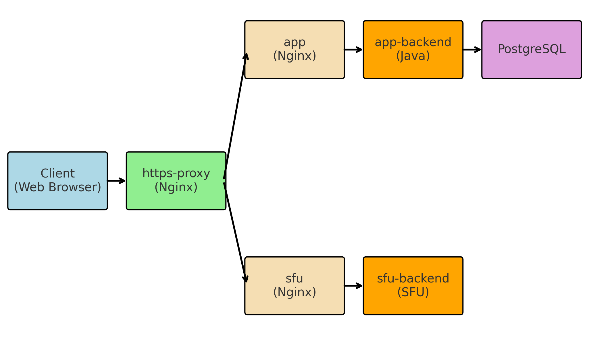

# docker-webmeeting

Docker Compose definitions to run WebMeeting, a WebRTC-based online meeting system, on a single server.

It runs the following services:

- The WebMeeting application server ( niicloudoperation/webmeeting-app ) and PostgreSQL
- The SFU with a built-in TURN server ( niicloudoperation/webmeeting-sfu )
- Nginx that terminates TLS on port 443 and routes each connection by its server name

The application server and the SFU can also run on separate servers.

# Installation

## Prerequisites

- A server with Docker Engine and Docker Compose
- Domain names for the following hosts, all resolving to the server
    - The application: mtg.example.com
    - The admin site: admin.mtg.example.com
    - A tenant: sample.mtg.example.com
    - The SFU: sfu.mtg.example.com
    - The TURN server: turn.mtg.example.com
- A TLS certificate and its private key for these names, or a certificate authority that supports ACME (see "Certificates by ACME")
- Port 443/TCP reachable from the clients

## Step 1: Download docker-webmeeting files

    $ git clone https://github.com/NII-cloud-operation/docker-webmeeting.git
    $ cd docker-webmeeting

## Step 2: Write your settings to override.env

default.env holds the default settings. Do not edit it; write the values to change to override.env in the same directory.

    APP_FQDN=mtg.example.com
    SERVICE_HOST=https://mtg.example.com
    SFU_FQDN=sfu.mtg.example.com
    SORA_SIGNALING_URL=wss://sfu.mtg.example.com/signaling
    TURN_FQDN=turn.mtg.example.com

    CERT_PATH=/etc/nginx/cert/server.crt
    KEY_PATH=/etc/nginx/cert/server.key

    SFU_IP_RANGE=10.128.128.0/24

    DB_PASSWORD=(password of the database)
    ADMIN_INITIAL_PASSWORD=(initial password of the admin account)

- SFU_IP_RANGE limits the addresses that can call the webhook of the application server. 10.128.128.0/24 is the Docker network that docker-compose.yml defines. The default 0.0.0.0/0 allows any address.
- DB_PASSWORD is set to the database when it is created at the first start. Changing it later does not change the password of the existing database.
- ADMIN_INITIAL_PASSWORD is required at the first start. The application server creates the account admin with this password when the admin site has no account yet, and does not start without it.

## Step 3: Install the TLS certificate and key

Create docker-compose.override.yml to mount the directory that holds the certificate and the key.

    services:
      https-proxy:
        volumes:
          - /path/to/cert:/etc/nginx/cert:ro

CERT_PATH and KEY_PATH in override.env are the paths in the container.
If an intermediate certificate is required, concatenate the server certificate and the intermediate certificate into the file of CERT_PATH.

## Step 4: Start WebMeeting

    $ docker compose --env-file default.env --env-file override.env up -d

The compose files take the image tag and the database account from the variables, so give both env files with --env-file.

## Step 5: Log in to the admin site

Open https://admin.mtg.example.com/ and log in as admin with ADMIN_INITIAL_PASSWORD.

Create a tenant whose identifier is sample. Its users log in at https://sample.mtg.example.com/ .
Nginx routes only the tenant name of SAMPLE_TENANT_SUBDOMAIN (default: sample) to the application server.

# Images

| Image | Contents |
|---|---|
| niicloudoperation/webmeeting-app | The application server |
| niicloudoperation/webmeeting-sfu | The SFU and the TURN server |

Each release is tagged with its date ( YYYYMMDD ) and latest.
The compose files use latest by default. To use a specific release, set WEBMEETING_IMAGE_TAG in override.env.

    WEBMEETING_IMAGE_TAG=20261113

# Options

The following variables are the main settings. See the comments in default.env for the others.

**APP_FQDN**, **SERVICE_HOST**

The domain name and the URL of the application.

**ADMIN_SUBDOMAIN**

The subdomain of the admin site. The default is admin. Do not change it after the first start.

**SAMPLE_TENANT_SUBDOMAIN**

The subdomain of the tenant that Nginx routes to the application server. The default is sample.

**SFU_FQDN**, **SORA_SIGNALING_URL**, **TURN_FQDN**

The domain names of the SFU and the TURN server, and the signaling URL that the browsers connect to.

**SFU_IP_RANGE**

The addresses that can call the webhook of the application server.

**APP_IP_RANGE**

The addresses that can call the API of the SFU.

**CERT_PATH**, **KEY_PATH**

The certificate and the private key in the container of https-proxy.

**DB_USERNAME**, **DB_PASSWORD**

The account of the database.

**ADMIN_INITIAL_PASSWORD**

The password of the account admin, created at the first start.

**MAIL_ENABLED**, **MAIL_***

The mail server. Mail is disabled by default.

**WEBMEETING_IMAGE_TAG**

The tag of the images. The default is latest.

# Running the application server and the SFU on separate servers

Use docker-compose.app.yml on the server of the application, and docker-compose.sfu.yml on the server of the SFU.

    $ docker compose --env-file default.env --env-file override.env -f docker-compose.app.yml up -d

    $ docker compose --env-file default.env --env-file override.env -f docker-compose.sfu.yml up -d

# Certificates by ACME

Instead of installing a certificate, https-proxy can use certificates issued by ACME with Certbot.
Add docker-compose.acme.yml to the compose files.
The overlay listens on port 80/TCP for the HTTP-01 challenge, so port 80 must be reachable from the certificate authority.
https-proxy starts after the first certificates are issued, and reads them from ACME_STATE_DIR; CERT_PATH, KEY_PATH and docker-compose.override.yml are not needed.

Set the contact address in override.env.

    ACME_EMAIL=your_email@example.com

Let's Encrypt:

    $ docker compose --env-file default.env --env-file override.env -f docker-compose.yml -f docker-compose.acme.yml up -d

## UPKI

UPKI requires an EAB credential for each certificate. Put the Key ID and the HMAC key of each certificate as files in UPKI_ACME_EAB_DIR (default: /var/lib/webmeeting/secrets/upki-acme), one value per file.

| Certificate | Key ID file | HMAC key file |
|---|---|---|
| APP_FQDN | app.kid | app.hmac |
| ADMIN_SUBDOMAIN.APP_FQDN | admin.kid | admin.hmac |
| SAMPLE_TENANT_SUBDOMAIN.APP_FQDN | sample.kid | sample.hmac |
| SFU_FQDN | sfu.kid | sfu.hmac |
| TURN_FQDN | turn.kid | turn.hmac |

The file names can be changed with ACME_EAB_(ROLE)_KID_FILE and ACME_EAB_(ROLE)_HMAC_KEY_FILE.
Use a separate ACME_STATE_NAME for UPKI.

    ACME_STATE_NAME=upki-production

Add docker-compose.acme.upki.yml as well.

    $ docker compose --env-file default.env --env-file override.env -f docker-compose.yml -f docker-compose.acme.yml -f docker-compose.acme.upki.yml up -d

For the separate servers, use docker-compose.acme.app.yml with docker-compose.app.yml, and docker-compose.acme.sfu.yml with docker-compose.sfu.yml.

The ACME account and the certificates are stored in ACME_STATE_DIR (default: /var/lib/webmeeting/acme). Back up this directory; an EAB credential of UPKI is used only once, when the account is registered.

# Logs

    $ docker compose --env-file default.env --env-file override.env logs -f app-backend
    $ docker compose --env-file default.env --env-file override.env logs -f sfu-backend
    $ docker compose --env-file default.env --env-file override.env logs -f https-proxy

# E2E tests

tests/e2e holds the end-to-end tests as Jupyter notebooks. Each step describes the operation and its expectation in Markdown, and drives Chromium with Playwright in the code cell. GitHub Actions runs them against the images on Docker Hub.

The Playwright helpers ( tests/e2e/notebooks/scripts/playwright.py ) are taken from [RCOSDP/RDM-e2e-test-nb](https://github.com/RCOSDP/RDM-e2e-test-nb), the notebook-based integration tests of GakuNin RDM (GRDM).

# About Internals

## Services

**https-proxy**

Nginx that terminates TLS on port 443. It routes each connection by its server name: the application, the admin site and the tenant to app, SFU_FQDN to sfu, and TURN_FQDN to the TURN server of sfu-backend.

**app**

Nginx in front of the application server. It allows the webhook ( /sora/webhook ) only from SFU_IP_RANGE.

**app-backend**

The WebMeeting application server.

**postgresql**

The database. The data is stored in the volume postgres_data_vol.

**sfu**

Nginx in front of the SFU. It routes the signaling ( /signaling ) to sfu-backend, and allows the API ( /api ) only from APP_IP_RANGE.

**sfu-backend**

The SFU. It renders conf/sfu.properties.j2 into its configuration at startup. The browsers send and receive the media through its TURN server, over TLS on port 443.
